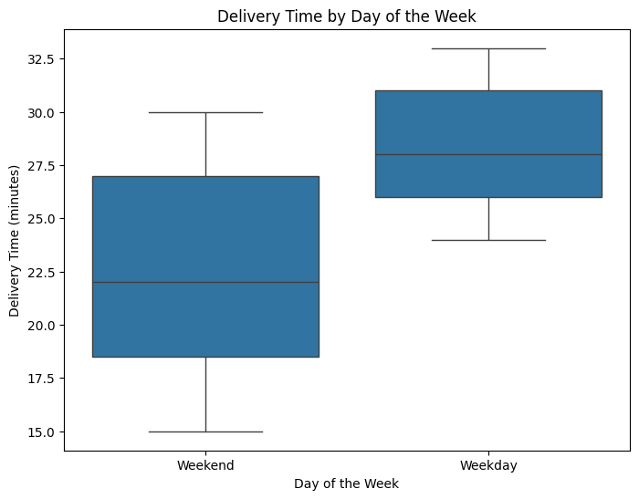

# FoodHub – Food Delivery Order Analysis

**Area:** Exploratory data analysis
**Tools:** Python, pandas, matplotlib, seaborn
**Notebook:** [`foodhub_eda.ipynb`](foodhub_eda.ipynb)


*Delivery time is about 6 minutes longer on weekdays than on weekends.*

## Problem
A food delivery aggregator wants to understand demand from its order data: which restaurants and cuisines are popular, how customers rate orders, and how long food takes to prepare and deliver. The goal is to give business recommendations from this analysis.

## Approach
- Cleaned the data (treated "Not given" ratings) and checked data quality
- Univariate and multivariate EDA on cost, cuisine, ratings, day of week, preparation and delivery time
- Answered business questions: top customers, revenue from commission, share of long deliveries

## Results
- **38.7%** of orders (736 of 1,898) have no rating – a big feedback gap
- Mean delivery time is **28.3 min on weekdays vs 22.5 min on weekends**
- **29.2%** of orders cost more than $20; net commission revenue is about **$6,166**
- **10.5%** of orders take more than 60 minutes from order to delivery
- American, Japanese and Italian are the top cuisines; American is the most popular on weekends

## How to run
```bash
pip install -r requirements.txt
jupyter notebook foodhub_eda.ipynb
```
Place the data files in `data/` first (see [data/README.md](data/README.md)). The notebook was built on Google Colab; on Colab, mount your Drive and update the data path.

---
*Completed as part of the UT Austin Post Graduate Program in Artificial Intelligence & Machine Learning.*
