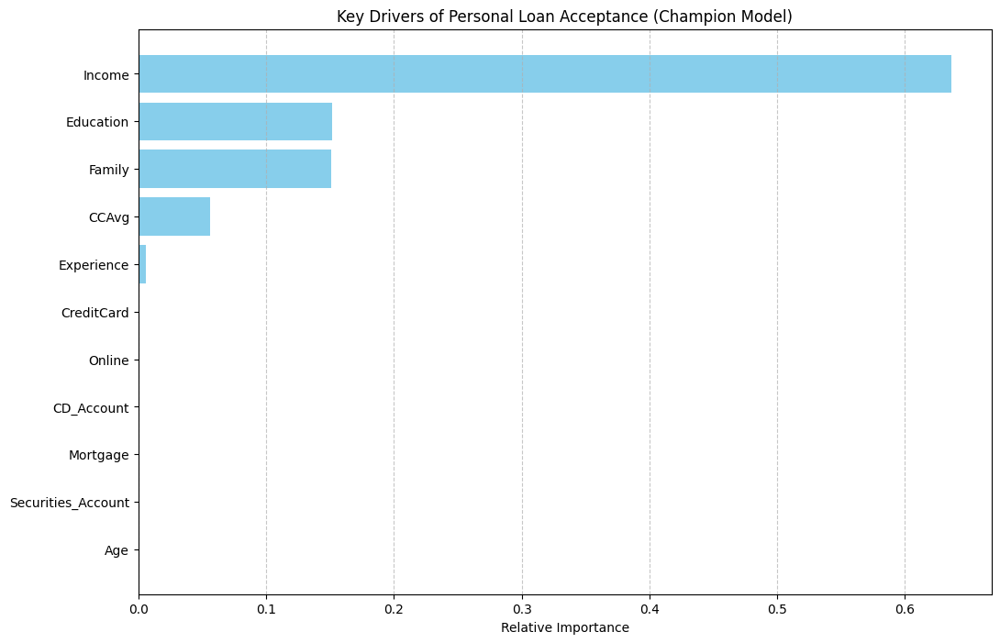

# Personal Loan Campaign – Customer Conversion Model

**Area:** Classification
**Tools:** Python, scikit-learn, Logistic Regression, Decision Trees
**Notebook:** [`personal_loan_campaign.ipynb`](personal_loan_campaign.ipynb)


*Income, education and family size drive personal loan acceptance (final post-pruned decision tree).*

## Problem
A retail bank wants to turn more of its deposit customers into personal loan customers. Using data from a past campaign, the task is to predict which customers are likely to accept a loan offer, so marketing can target them better.

## Approach
- EDA and sanity checks (fixed negative experience values, checked correlations)
- Logistic Regression baseline with threshold tuning for recall
- Decision Tree: unpruned, pre-pruned (grid search) and post-pruned (cost complexity pruning)
- Compared all models on the test set with **recall** as the main metric (missing a likely borrower costs the bank more)

## Results
| Model | Accuracy | Recall | Precision | F1 |
|---|---|---|---|---|
| Logistic Regression (threshold 0.1) | 0.893 | 0.847 | 0.467 | 0.602 |
| Initial Decision Tree | 0.981 | 0.889 | 0.914 | 0.901 |
| Tuned Decision Tree | 0.966 | 0.944 | 0.760 | 0.842 |
| **Post-Pruned Decision Tree (final)** | **0.961** | **0.965** | 0.724 | 0.827 |

Key drivers of loan acceptance: income, education level, family size, CD account and credit card spend (CCAvg).

## How to run
```bash
pip install -r requirements.txt
jupyter notebook personal_loan_campaign.ipynb
```
Place the data files in `data/` first (see [data/README.md](data/README.md)). The notebook was built on Google Colab; on Colab, mount your Drive and update the data path.

---
*Completed as part of the UT Austin Post Graduate Program in Artificial Intelligence & Machine Learning.*
