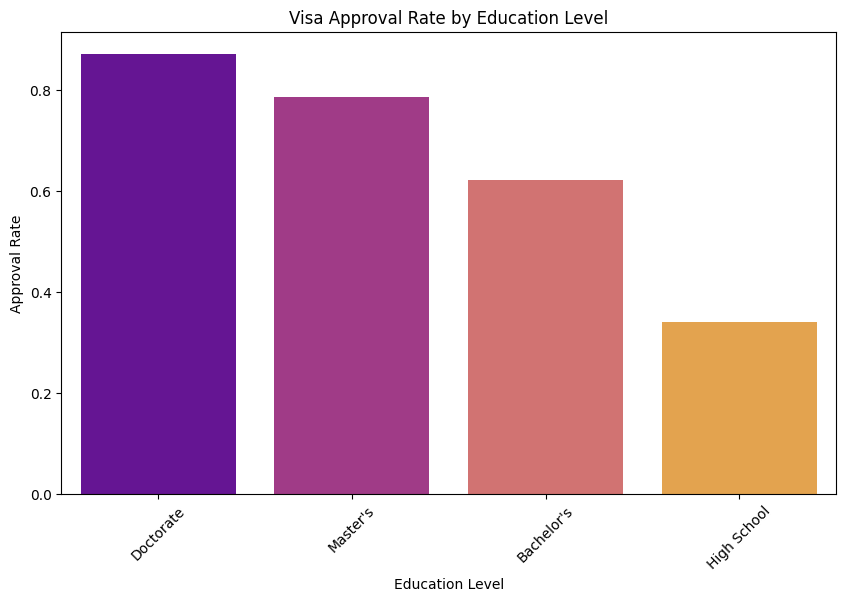

# EasyVisa – Visa Approval Prediction

**Area:** Classification, ensemble models, imbalanced data
**Tools:** Python, scikit-learn, imbalanced-learn (SMOTE, undersampling), Bagging, Random Forest, AdaBoost, Gradient Boosting
**Notebook:** [`easyvisa_visa_approval.ipynb`](easyvisa_visa_approval.ipynb)


*Approval rate rises with education: about 87% for doctorate vs 34% for high school.*

## Problem
The US labor certification office gets more work visa applications every year, and checking each case by hand is slow. The task is to predict whether an application will be **certified or denied**, and to find which applicant and employer factors drive the decision, so cases can be shortlisted faster.

## Approach
- EDA on education, job experience, wage, region, company size and continent
- Cleaned the data and normalised prevailing wage across hourly / weekly / monthly / yearly units
- Trained 5 models (Decision Tree, Random Forest, Bagging, AdaBoost, Gradient Boosting) on 3 versions of the data: original, SMOTE oversampled and randomly undersampled – 15 models in total
- Tuned the top 3 models with grid search; **F1 score** used as the main metric because the classes are imbalanced

## Results
| Model (test set) | Accuracy | Precision | Recall | F1 |
|---|---|---|---|---|
| **Gradient Boosting, tuned, original data (final)** | **0.742** | 0.770 | **0.875** | **0.819** |
| AdaBoost, tuned, original data | 0.742 | 0.773 | 0.870 | 0.819 |
| Gradient Boosting, tuned, SMOTE data | 0.739 | 0.780 | 0.849 | 0.813 |
| Random Forest, original data | 0.722 | 0.767 | 0.837 | 0.801 |
| Decision Tree, original data | 0.660 | 0.746 | 0.745 | 0.746 |

- About 67% of cases are certified and 33% denied
- Education is the strongest driver: approval is ~87% for doctorate holders vs ~34% for high school
- Prior job experience raises approval (74% vs 56%); higher prevailing wage also helps
- Approval differs by continent (Europe highest, South America lowest) and US region (Midwest highest)
- Single decision trees and random forests overfit (train F1 = 1.0); boosting models generalised best

## How to run
```bash
pip install -r requirements.txt
jupyter notebook easyvisa_visa_approval.ipynb
```
Place the data files in `data/` first (see [data/README.md](data/README.md)). The notebook was built on Google Colab; on Colab, mount your Drive and update the data path.

---
*Completed as part of the UT Austin Post Graduate Program in Artificial Intelligence & Machine Learning.*
