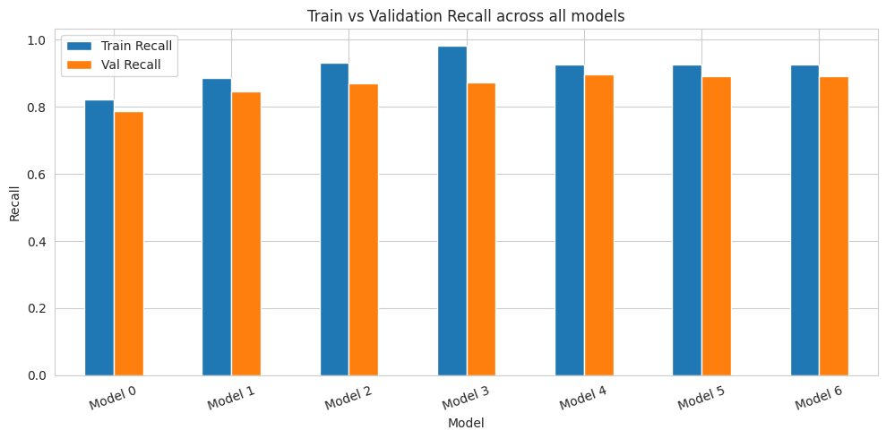

# ReneWind – Wind Turbine Failure Prediction

**Area:** Neural networks, imbalanced classification
**Tools:** Python, TensorFlow/Keras, scikit-learn
**Notebook:** [`renewind_predictive_maintenance.ipynb`](renewind_predictive_maintenance.ipynb)


*Train vs validation recall across the 7 neural networks.*

## Problem
Wind turbine generator failures are costly. Sensor readings can warn about failures early, so the turbine can be inspected or repaired before a full replacement is needed. The task is to predict failures from 40 anonymised sensor features, where replacement costs more than repair and repair costs more than inspection.

## Approach
- EDA on 40 sensor features; checked skew and correlations
- Median imputation and scaling fitted only on training data (no leakage)
- Built 7 neural networks step by step: deeper layers, SGD vs Adam, class weights, dropout, momentum
- Chose **recall on the failure class** as the main metric, because a missed failure is the most expensive mistake

## Results
Validation scores on the failure class (4,000 rows, 222 failures):

| Model | Train Recall | Val Recall | Val Precision | Val F1 |
|---|---|---|---|---|
| Model 0 – 1 hidden layer, SGD | 0.821 | 0.788 | 0.978 | 0.873 |
| Model 1 – 3 hidden layers, SGD | 0.886 | 0.847 | 0.979 | 0.908 |
| Model 2 – Adam | 0.932 | 0.869 | 0.946 | 0.906 |
| Model 3 – Adam + class weights | 0.983 | 0.874 | 0.878 | 0.876 |
| **Model 4 – Adam + class weights + dropout (final)** | 0.925 | **0.896** | 0.926 | 0.911 |
| Model 5 – wider/deeper + dropout | 0.927 | 0.892 | 0.888 | 0.890 |
| Model 6 – SGD momentum + class weights + dropout | 0.926 | 0.892 | 0.938 | 0.915 |

**Final model on the test set (5,000 rows):** recall **0.883**, precision 0.915, F1 0.899, accuracy 0.989.

- Data is highly imbalanced (~94.5% no failure vs ~5.5% failure), so accuracy alone is misleading
- Class weights and dropout together gave the best recall without hurting precision much
- The model is meant as an early-warning layer: flagged turbines go for inspection before repair or replacement

## How to run
```bash
pip install -r requirements.txt
jupyter notebook renewind_predictive_maintenance.ipynb
```
Place the data files in `data/` first (see [data/README.md](data/README.md)). The notebook was built on Google Colab; on Colab, mount your Drive and update the data path.

---
*Completed as part of the UT Austin Post Graduate Program in Artificial Intelligence & Machine Learning.*
