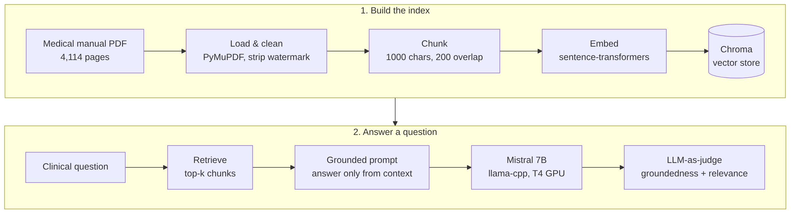

# Medical Assistant – RAG over a Clinical Manual

**Area:** NLP, LLMs, Retrieval-Augmented Generation
**Tools:** Python, LangChain, ChromaDB, sentence-transformers, llama-cpp (Mistral 7B), Hugging Face Hub
**Notebook:** [`medical_assistant_rag.ipynb`](medical_assistant_rag.ipynb)


*RAG pipeline: index the manual once, then retrieve, answer and evaluate for each question.*

## Problem
Clinicians need fast, reliable answers from large medical references. The task is to build an assistant that answers clinical questions using a 4,000+ page medical manual as its knowledge source, and to compare it with a plain LLM.

## Approach
- Baseline: open-weight 7B LLM (Mistral, GGUF via llama-cpp) answering 5 clinical questions with no context
- Prompt engineering: tried 5 prompt and generation settings
- RAG pipeline: PDF loading (PyMuPDF), cleaning, chunking, embeddings, Chroma vector store, retriever
- Tuned chunk size, overlap, top-k and MMR vs similarity search
- LLM-as-judge evaluation on **groundedness** and **relevance**, comparing baseline vs RAG

## Results
- Prompt engineering improved answer *structure*, but only retrieval improved answer *substance*
- Semantic search found the right chapter even when the question did not name the condition (for example, "sudden patchy hair loss" → alopecia areata)
- RAG answers scored much higher on groundedness than the baseline; relevance was weaker on multi-part questions, which points to a retrieval limit
- Runs fully on a single T4 GPU with an open-weight model – no data leaves the environment

## How to run
```bash
pip install -r requirements.txt
jupyter notebook medical_assistant_rag.ipynb
```
Place the data files in `data/` first (see [data/README.md](data/README.md)). The notebook was built on Google Colab; on Colab, mount your Drive and update the data path.

---
*Completed as part of the UT Austin Post Graduate Program in Artificial Intelligence & Machine Learning.*
