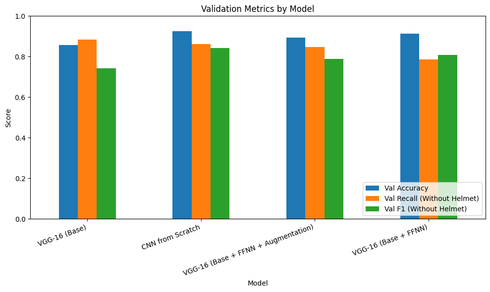

# HelmNet – Safety Helmet Detection

**Area:** Computer vision, CNNs, transfer learning
**Tools:** Python, TensorFlow/Keras, VGG-16, OpenCV
**Notebook:** [`helmnet_helmet_detection.ipynb`](helmnet_helmet_detection.ipynb)


*Validation accuracy, recall and F1 for the "without helmet" class across the 4 models.*

## Problem
On construction and industrial sites, workers without helmets are at serious risk. Checking camera footage by hand does not scale. The task is to classify worker images as **with helmet** or **without helmet** so that safety violations can be flagged automatically.

## Approach
- EDA on images and labels; checked class imbalance
- Train/validation/test split, normalisation, class weights
- Model 1: CNN from scratch
- Model 2: VGG-16 transfer learning (base)
- Model 3: VGG-16 + feed-forward head
- Model 4: VGG-16 + feed-forward head + data augmentation
- Compared models with focus on recall for the "without helmet" class

## Results
Validation scores (619 images; "without helmet" is the class that matters):

| Model | Train Acc | Val Acc | Val Recall (without helmet) | Val Precision (without helmet) | Val F1 (without helmet) |
|---|---|---|---|---|---|
| CNN from scratch | 0.976 | 0.924 | 0.862 | 0.822 | 0.842 |
| **VGG-16 base (final)** | 0.904 | 0.856 | **0.883** | 0.640 | 0.742 |
| VGG-16 + FFNN | 0.975 | 0.913 | 0.786 | 0.832 | 0.809 |
| VGG-16 + FFNN + augmentation | 0.920 | 0.893 | 0.848 | 0.737 | 0.788 |

**Final model on the test set:** accuracy 0.879, recall for "without helmet" **0.90** (precision 0.68).

- The final model was chosen on "without helmet" recall, because missing a worker without a helmet is the costly mistake
- Only ~23% of images are "without helmet", so accuracy alone is misleading
- The CNN from scratch had the best F1; the VGG-16 base catches more violations but raises more false alarms – a good fit with a human review step
- Recommended a human-in-the-loop review for low-confidence predictions and collecting more "without helmet" images

## How to run
```bash
pip install -r requirements.txt
jupyter notebook helmnet_helmet_detection.ipynb
```
Place the data files in `data/` first (see [data/README.md](data/README.md)). The notebook was built on Google Colab; on Colab, mount your Drive and update the data path.

---
*Completed as part of the UT Austin Post Graduate Program in Artificial Intelligence & Machine Learning.*
