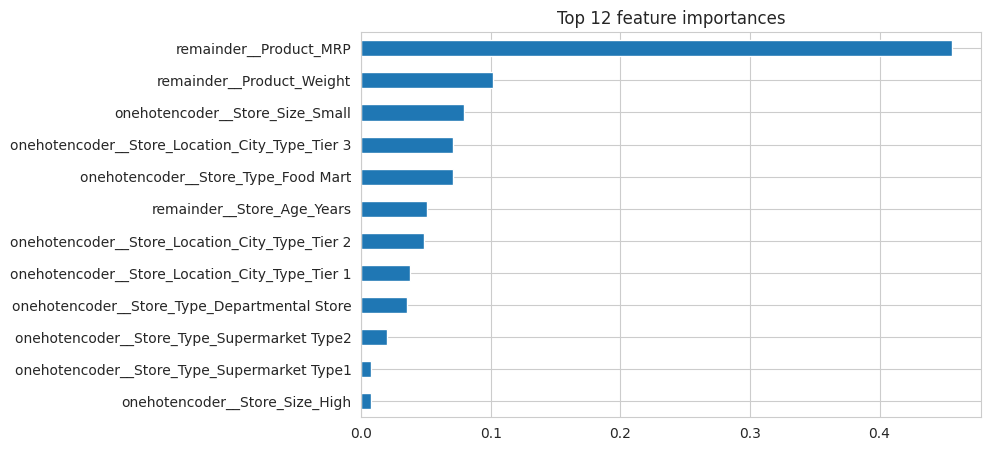

# SuperKart – Sales Forecasting and Model Deployment

**Area:** Regression, MLOps, deployment
**Tools:** Python, scikit-learn, Flask, Streamlit, Docker, Hugging Face Spaces
**Notebook:** [`superkart_sales_forecasting.ipynb`](superkart_sales_forecasting.ipynb)


*Product MRP is by far the most important feature in the final Random Forest model.*

## Problem
A retail chain wants to forecast how much each product will sell in each store, to plan stock and spot growth opportunities. The task covers the full path: build the model, then deploy it as a working API and web app.

## Approach
- EDA, feature engineering (store age, product ID prefix, product category), outlier checks
- scikit-learn pipelines with preprocessing + model
- Random Forest and Gradient Boosting, base and tuned (hyperparameter search)
- Serialised the best pipeline with joblib and verified it reloads identically
- **Flask REST API** backend (single and batch prediction) and **Streamlit** frontend, each in a Docker container on Hugging Face Spaces
- Hugging Face token read from a secret, never stored in the notebook

## Results
| Model | Train RMSE | Test RMSE | Test MAE | Test R² | Test MAPE |
|---|---|---|---|---|---|
| **Random Forest (tuned, final)** | 198.2 | **278.6** | 105.4 | **0.932** | 3.8% |
| Random Forest (base) | 106.7 | 286.5 | 110.3 | 0.928 | 4.0% |
| Gradient Boosting (tuned) | 271.7 | 302.8 | 132.8 | 0.920 | 4.7% |
| Gradient Boosting (base) | 294.9 | 308.6 | 143.9 | 0.917 | 5.0% |

- Product MRP (corr 0.79) and product weight (0.74) are the main sales drivers; shelf area has little effect
- Sales per product range from ~4,947 (Tier 1 departmental store) to ~1,763 (Tier 3 food mart)
- One store brings in about half of total revenue

## How to run
```bash
pip install -r requirements.txt
jupyter notebook superkart_sales_forecasting.ipynb
```
Place the data files in `data/` first (see [data/README.md](data/README.md)). The notebook was built on Google Colab; on Colab, mount your Drive and update the data path.

---
*Completed as part of the UT Austin Post Graduate Program in Artificial Intelligence & Machine Learning.*
